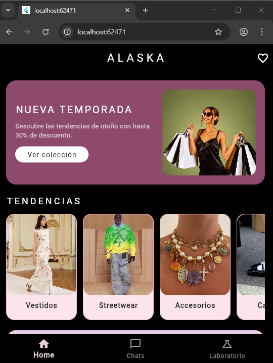
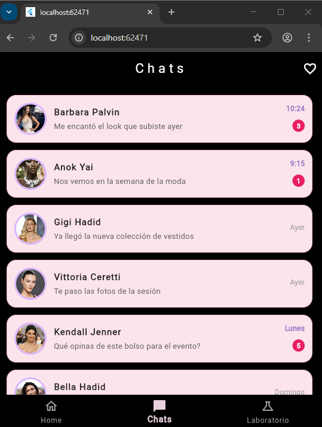
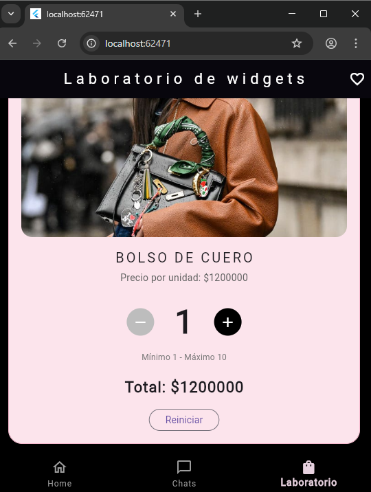

# Alaska

Aplicación móvil de moda desarrollada en Flutter y Dart.

## Descripción

Alaska es una app de moda con tres secciones conectadas por una barra de navegación inferior:

- **Home:** banner promocional de nueva temporada, carrusel horizontal de tendencias y publicaciones de usuarios con botón de "Me gusta".
- **Chats:** lista de conversaciones con usuarios, último mensaje, hora e indicador de mensajes sin leer.
- **Laboratorio de widgets:** selector de cantidad de un producto con botones para sumar, restar y reiniciar, límites de 1 a 10 y cálculo del total.

## Estructura del proyecto

lib/
├── main.dart
├── screens/
│ ├── chats_screen.dart
│ ├── home_screen.dart
│ └── laboratory_screen.dart
└── widgets/
├── chat_tile.dart
├── image_carousel.dart
├── numeric_counter.dart
├── post_card.dart
└──promotional_banner.dart

## Cómo ejecutarlo

1. Tener instalado Flutter y un emulador, dispositivo o Chrome.
2. Clonar el repositorio.
3. Abrir la carpeta del proyecto en la terminal y ejecutar:
flutter pub get
flutter run

## Capturas

### Home

### Chats

### Laboratorio de widgets

## Video de funcionamiento

Navegación, botón "Me gusta" y cambio de la variable numérica: https://drive.google.com/file/d/1PUky8UTkecOz-iw3uUVZnzT3m_Zn2NIB/view?usp=sharing

## Autora

Hanna Gabriela Castaño Beltran

